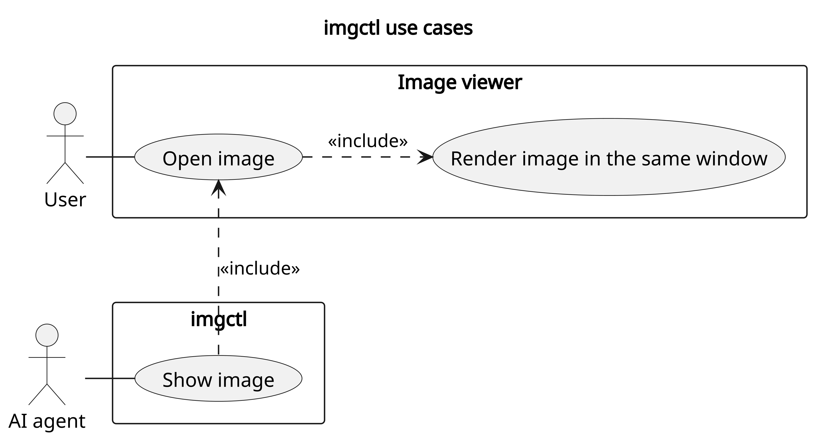
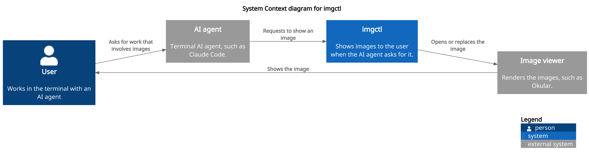

# imgctl

[use cases](#use-cases) · [system context](#system-context) · [prerequisites](#prerequisites) · [install](#install) · [project structure](#project-structure) · [docs](#docs) · [development](#development)

[what imgctl is, in one short line.]

- **Show image** — your terminal AI agent shows you an image in the image viewer, so you don't have to open it manually. If the viewer already has an image open, imgctl reuses that window.

## use cases



## system context



## prerequisites

- [what must be installed first, and the minimum version]
- [what must be installed first, and the minimum version]

## install

```sh
[install command]
```

or [other ways to install, separated by ·]

then start it where the work lives:

```sh
imgctl
```

[what to do first, and how to stop.]

## project structure

```
imgctl/
├── imgctl.sh            # the script
└── docs/
    ├── requirements.md  # what imgctl must do
    ├── vocabulary.md    # names and their meaning in the project
    ├── decisions/       # architecture decision records
    ├── diagrams/        # PlantUML sources and their images
    └── logs/            # learning, regrets and progress
```

## docs

everything lives in [docs/](docs/): [requirements](docs/requirements.md) · [decisions](docs/decisions/)

decisions:

- [ADR-001: Programming Language](docs/decisions/ADR-001-programming-language.md)
- [ADR-002: No MCP](docs/decisions/ADR-002-no-mcp.md)

## development

```sh
git clone https://github.com/prapoju/imgctl
cd imgctl
[build command]

[test command]    # unit tests
[check command]   # formatting, tests, and maintenance checks
```
